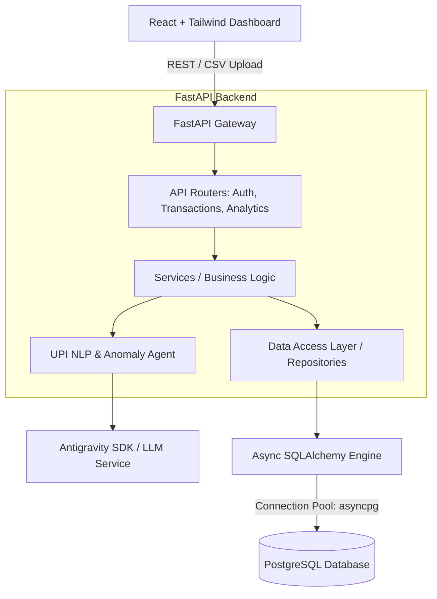
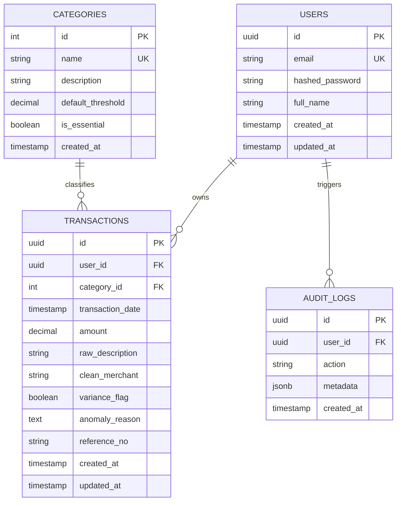
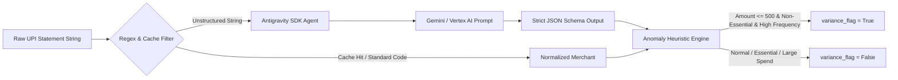

# Architecture Plan: Variance Tracker
**Micro-Expenditure & Anomaly Detection System**  
*Master of Computer Applications (MCA) Minor Project — Meghnad Saha Institute of Technology*

---

## 1. Executive Summary & Academic Context
**Variance Tracker** is an intelligent micro-expenditure and anomaly detection platform designed to ingest unstructured digital banking (UPI, IMPS, NEFT, Card) transaction streams, normalize irregular merchant identifiers using NLP and heuristics, and isolate low-value recurring expenditure anomalies (e.g., micro-spends under ₹500 draining daily cash reserves).

- **Backend:** FastAPI (Python 3.11+), Asynchronous SQLAlchemy 2.0 with `asyncpg`, Pydantic v2 schemas.
- **Database:** PostgreSQL (Strict 3NF Normalization, Indexing on temporal and categorical dimensions).
- **Frontend:** React 18+ (Vite), Tailwind CSS, Recharts / Chart.js, Lucide Icons.
- **NLP / AI Engine:** Google Antigravity Agent / Gemini multimodal inference with structured JSON output + deterministic regex pre-processing fallback.

---

## 2. System Architecture & Separation of Concerns (MVC)



---

## 3. Database Schema Specification (3NF Normalized)

To satisfy academic evaluation criteria for Third Normal Form (3NF), every non-key attribute is non-transitively dependent on the primary key, with zero transitive dependencies.

### 3.1 Entity Relationship Diagram



### 3.2 SQL Relational Definitions (DDL Highlights)

```sql
-- 1. Users Table
CREATE TABLE users (
    id UUID PRIMARY KEY DEFAULT gen_random_uuid(),
    email VARCHAR(255) UNIQUE NOT NULL,
    hashed_password VARCHAR(255) NOT NULL,
    full_name VARCHAR(128) NOT NULL,
    created_at TIMESTAMPTZ DEFAULT CURRENT_TIMESTAMP,
    updated_at TIMESTAMPTZ DEFAULT CURRENT_TIMESTAMP
);

-- 2. Categories Table (3NF: Eliminates transitive categorical anomalies)
CREATE TABLE categories (
    id SERIAL PRIMARY KEY,
    name VARCHAR(64) UNIQUE NOT NULL,
    description TEXT,
    default_threshold NUMERIC(10, 2) DEFAULT 500.00,
    is_essential BOOLEAN DEFAULT FALSE,
    created_at TIMESTAMPTZ DEFAULT CURRENT_TIMESTAMP
);

-- 3. Transactions Table (Core Ledger)
CREATE TABLE transactions (
    id UUID PRIMARY KEY DEFAULT gen_random_uuid(),
    user_id UUID NOT NULL REFERENCES users(id) ON DELETE CASCADE,
    category_id INT NOT NULL REFERENCES categories(id) ON DELETE RESTRICT,
    transaction_date TIMESTAMPTZ NOT NULL,
    amount NUMERIC(12, 2) NOT NULL CHECK (amount > 0),
    raw_description TEXT NOT NULL,
    clean_merchant VARCHAR(128) NOT NULL,
    variance_flag BOOLEAN DEFAULT FALSE,
    anomaly_reason TEXT,
    reference_no VARCHAR(64),
    created_at TIMESTAMPTZ DEFAULT CURRENT_TIMESTAMP,
    updated_at TIMESTAMPTZ DEFAULT CURRENT_TIMESTAMP
);

-- Indexes for High-Performance Analytical Queries
CREATE INDEX idx_transactions_user_date ON transactions(user_id, transaction_date DESC);
CREATE INDEX idx_transactions_variance ON transactions(user_id, variance_flag) WHERE variance_flag = TRUE;
CREATE INDEX idx_transactions_category ON transactions(category_id);
```

---

## 4. API Endpoints Specification

All endpoints enforce strict Pydantic v2 validation models, academic docstrings, and standard HTTP response status codes.

| Method | Endpoint | Description | Request Body / Params | Response |
| :--- | :--- | :--- | :--- | :--- |
| `POST` | `/api/v1/auth/register` | Register new user | `UserRegisterSchema` | `UserResponseSchema` (201) |
| `POST` | `/api/v1/auth/login` | OAuth2 Token Login | `OAuth2PasswordRequestForm` | `TokenSchema` (200) |
| `GET` | `/api/v1/users/me` | Fetch authenticated profile | Bearer Token | `UserResponseSchema` (200) |
| `POST` | `/api/v1/transactions/ingest-csv` | Stream ingest CSV transaction statements | Multipart Form-Data (`file: .csv`) | `IngestionSummarySchema` (200) |
| `GET` | `/api/v1/transactions/` | Paginated transaction listing with filters | `page, limit, category, variance_only` | `PaginatedTransactionsSchema` (200) |
| `POST` | `/api/v1/transactions/` | Manual transaction creation | `TransactionCreateSchema` | `TransactionResponseSchema` (201) |
| `GET` | `/api/v1/analytics/daily-burn-rate` | Aggregated daily burn rate over date range | `start_date, end_date` | `DailyBurnRateResponse` (200) |
| `GET` | `/api/v1/analytics/categorical-variance` | Category-wise spend breakdown vs variance | `start_date, end_date` | `CategoricalVarianceResponse` (200) |
| `GET` | `/api/v1/analytics/anomalies` | Filtered list of identified micro-expenditure anomalies | `limit, threshold` | `AnomalyListResponse` (200) |
| `POST` | `/api/v1/nlp/parse-raw` | Direct test endpoint for single UPI string | `RawUPIParseRequest` | `ParsedUPISchema` (200) |

---

## 5. NLP & Anomaly Detection Pipeline



### Anomaly Classification Criteria:
1. **Micro-Value Constraint:** Spends $\le ₹500$.
2. **Category Classification:** Non-essential categories (e.g., Snacks, Tea/Coffee, Fast Food, Digital Vending, Micro-Subscriptions).
3. **Behavioral Recurrence:** High intraday or multi-day frequency from merchant stems.
4. **Output Schema:**
   ```json
   {
     "clean_merchant": "Chai Point",
     "category": "Food/Beverage",
     "variance_flag": true,
     "reason": "Recurring low-value micro-expenditure under ₹500 in non-essential category"
   }
   ```

---

## 6. Frontend Architecture & Modular Component Tree

```text
frontend/
├── public/
│   └── favicon.ico
├── src/
│   ├── assets/
│   ├── components/
│   │   ├── common/
│   │   │   ├── Navbar.jsx
│   │   │   ├── Sidebar.jsx
│   │   │   ├── StatCard.jsx
│   │   │   └── Modal.jsx
│   │   ├── ingestion/
│   │   │   ├── DropZone.jsx            # Drag-and-drop CSV upload with file preview
│   │   │   └── UploadProgress.jsx      # Progress bar & ingestion validation log
│   │   ├── analytics/
│   │   │   ├── DailyBurnRateChart.jsx  # Recharts/Chart.js Area/Histogram chart
│   │   │   ├── CategoricalHeatmap.jsx  # Category-wise variance distribution
│   │   │   └── AnomalyListTable.jsx    # Anomaly badge table with reason popover
│   │   └── transactions/
│   │       ├── TransactionFilter.jsx
│   │       └── TransactionTable.jsx
│   ├── context/
│   │   └── AuthContext.jsx
│   ├── hooks/
│   │   ├── useAnalytics.js
│   │   └── useTransactions.js
│   ├── services/
│   │   ├── api.js                     # Axios/Fetch base client with JWT interceptor
│   │   ├── transactionService.js
│   │   └── analyticsService.js
│   ├── pages/
│   │   ├── DashboardPage.jsx          # Main Mission Control View
│   │   ├── IngestionPage.jsx          # Dedicated CSV ingestion & staging view
│   │   ├── TransactionsPage.jsx       # Ledger view
│   │   └── LoginPage.jsx
│   ├── App.jsx
│   ├── index.css                      # Tailwind imports & custom design tokens
│   └── main.jsx
├── index.html
├── package.json
├── tailwind.config.js
└── vite.config.js
```

---

## 7. Backend Repository Structure

```text
backend/
├── app/
│   ├── core/
│   │   ├── config.py                  # Pydantic Settings (.env loader)
│   │   ├── database.py                # Async engine & sessionmaker (asyncpg)
│   │   └── security.py                # Password hashing & JWT generation
│   ├── models/
│   │   ├── __init__.py
│   │   ├── user.py                    # SQLAlchemy User model
│   │   ├── category.py                # SQLAlchemy Category model
│   │   └── transaction.py             # SQLAlchemy Transaction model
│   ├── schemas/
│   │   ├── __init__.py
│   │   ├── user.py                    # Pydantic v2 User schemas
│   │   ├── category.py                # Category schemas
│   │   ├── transaction.py             # Transaction & CSV Ingestion schemas
│   │   └── analytics.py               # Aggregation & Anomaly DTOs
│   ├── services/
│   │   ├── auth_service.py            # User registration/authentication
│   │   ├── transaction_service.py     # Ingestion & CRUD business logic
│   │   ├── nlp_service.py             # Google Antigravity SDK & Regex agent
│   │   └── analytics_service.py       # SQL aggregation calculations
│   ├── routers/
│   │   ├── __init__.py
│   │   ├── auth.py                    # /api/v1/auth
│   │   ├── transactions.py            # /api/v1/transactions
│   │   ├── analytics.py               # /api/v1/analytics
│   │   └── nlp.py                     # /api/v1/nlp
│   └── main.py                        # FastAPI application factory & CORS setup
├── migrations/                        # Alembic async migration environment
│   ├── env.py
│   └── script.py.mako
├── tests/
│   ├── test_auth.py
│   ├── test_nlp.py
│   └── test_transactions.py
├── alembic.ini
├── requirements.txt
└── .env.example
```

---

## 8. Staged Execution Plan (Pending User Approval)

| Phase | Milestone | Execution Deliverables |
| :--- | :--- | :--- |
| **Phase 1** | **Backend Scaffolding & Database Layer** | Set up `backend/` directory, virtual environment, `requirements.txt`, async SQLAlchemy connection pool, Alembic migration scripts, and seed default categories. |
| **Phase 2** | **NLP & Anomaly Logic Integration** | Implement `nlp_service.py` with Antigravity Agent wrapper and fallback heuristic parser for Indian UPI transactions; bind with Pydantic response models. |
| **Phase 3** | **API Routers & Business Logic** | Build routers for CSV parsing, transaction querying, and SQL analytical aggregations (Daily Burn Rate, Categorical Variance, Anomalies). |
| **Phase 4** | **Frontend React Dashboard Scaffolding** | Initialize Vite + React + Tailwind CSS client, install Chart.js / Recharts, configure theme & layout with glassmorphic cards. |
| **Phase 5** | **Frontend Analytics Components** | Build Drag-and-Drop CSV dropzone with schema mapper, Daily Burn Rate Chart, Categorical Heatmap panel, and Anomaly table. |
| **Phase 6** | **End-to-End Validation & Verification** | Test CSV ingestion with sample Indian UPI datasets, verify anomaly detection thresholds, check API documentation (`/docs`), and ensure 3NF database integrity. |
